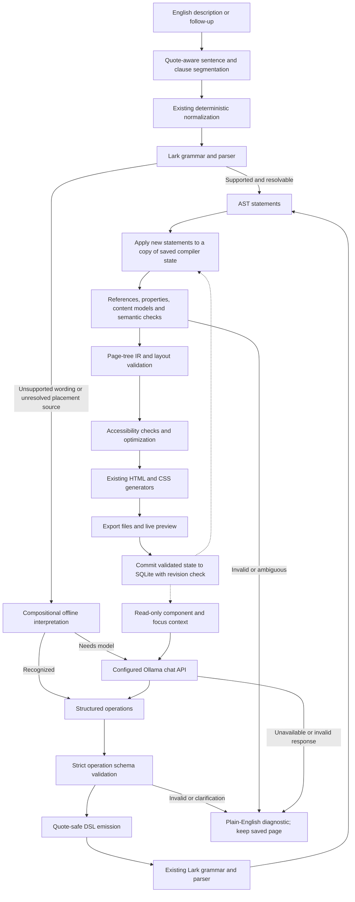

# NLP-assisted Text2Web

## What was wrong

Before this enhancement, the Flask handler called `compile_source(source)` without
the existing `nlp_converter` hook. That hook accepted an optional callable returning
DSL, but no language model, provider settings or structured response schema existed.
`english.py` translated full-sentence regex patterns, and the grammar required a
quoted page title. Consequently, ordinary wording such as “Create a web page called
Abhishek” failed before any NLP could help. A sentence could also parse into the
wrong operation: “Put a large heading saying … below …” looked like a reference to
an existing heading rather than creation.

Every POST originally created a new CompilationResult from an empty symbol table.
There was no persisted document to modify. Type references silently selected the
last element of that type; `it` always meant the last introduced element, even
when a multi-card request had introduced several possible targets. Nav foregrounds
could remain blue against a newly green background. These issues were confirmed
in source and tests; the initial baseline was **220 passing tests**, including
12 Chrome viewport checks.

## Boundaries and data flow



The model produces data, never HTML, JavaScript or AST objects. Operations are
validated, rendered into quoted DSL, then parsed by the existing grammar. Compiler
semantics remain authoritative for types, property values, destinations, nesting,
references, layout and selected accessibility rules. Local/offline derived nav
foreground defaults use the validated background color and remain subject to the
same contrast check.

## Start the editor on this machine

```powershell
cd "C:\Users\abhis\OneDrive\Desktop\testing\compiler-project-main"
.\.venv\Scripts\python.exe app.py
```

Open **http://127.0.0.1:5000**. The default is offline English interpretation, with
no credentials, paid API or network service. The editor loads
`examples/natural-review.sp`, which can be compiled directly. **Compile Webpage**
starts/replaces a page from a full description. **Apply follow-up** modifies the
saved page using only the new instruction. **Open saved page** returns to the last
successful revision after a failed edit.

Examples verified by automated tests:

```text
Create a web page called Abhishek.
```

```text
Build me a website named Techno Fest.
Add a green navigation bar with Home, About and Contact.
Put a large heading saying Welcome to Techno Fest below the navbar.
Add a Register button below the heading.
Make the button rounded.
Make the layout responsive for mobile.
```

Then enter a follow-up:

```text
Change the navbar background to dark green and add a Volunteer button below the heading.
```

Use `Make the first button rounded` if the page has multiple buttons. A page title
sets the browser tab title; a heading creates visible page content. Images require
an actual URL/filename and an alternative-text description. Missing data produces
a clarification instead of a fabricated image or description.

## Configure genuine local-model interpretation

The adapter supports Ollama's local `/api/chat` endpoint with a JSON schema in
`format`, `stream: false`, temperature 0 and a fixed seed. The response is validated
again locally. See [Ollama structured outputs](https://docs.ollama.com/capabilities/structured-outputs)
and the [chat API](https://docs.ollama.com/api/chat).

Install [Ollama for Windows](https://docs.ollama.com/windows), then download a local
model. The configurable default is [qwen2.5:3b](https://ollama.com/library/qwen2.5:3b),
listed at about 1.9 GB for its model download. The runtime requires additional disk
space and model inference uses local CPU/GPU and memory. This is a practical small
local-model candidate, not a measured accuracy recommendation for this project.

```powershell
ollama pull qwen2.5:3b
```

The Windows app normally runs Ollama in the background. If using the standalone
CLI, start `ollama serve` in a separate terminal. Configure and start Text2Web in
the same PowerShell window:

```powershell
cd "C:\Users\abhis\OneDrive\Desktop\testing\compiler-project-main"
$env:TEXT2WEB_NLP_BACKEND = 'ollama'
$env:TEXT2WEB_NLP_MODEL = 'qwen2.5:3b'
$env:TEXT2WEB_NLP_URL = 'http://127.0.0.1:11434'
$env:TEXT2WEB_NLP_TIMEOUT = '20'
.\.venv\Scripts\python.exe app.py
```

`TEXT2WEB_NLP_API_KEY` is optional for an authenticated Ollama-compatible gateway.
It is read on the server and placed in an Authorization header; it is never added
to frontend code, model prompts, generated HTML/CSS or inspector data. The model
URL comes from server configuration, never a user prompt. This integration targets
the local Ollama API; it is not an OpenAI API adapter or a promise that cloud APIs
support the same structured-output contract.

| Setting | Default / behavior |
| --- | --- |
| TEXT2WEB_NLP_BACKEND | offline; or ollama to enable the local model |
| TEXT2WEB_NLP_MODEL | qwen2.5:3b |
| TEXT2WEB_NLP_URL | http://127.0.0.1:11434 |
| TEXT2WEB_NLP_TIMEOUT | 20 seconds; configurable up to 120 |
| TEXT2WEB_NLP_API_KEY | Optional server-only gateway credential |

Timeouts, missing models, connection failures, rate limits, incomplete responses,
oversized responses and invalid schemas produce plain diagnostics without exposing
service internals. There are no hidden retries or downloads. Common offline
instructions continue working during outages. Unrecognized wording fails visibly;
it is never silently reinterpreted as a different page.

**Live-model status:** no Ollama executable or running local service was available
in this workspace during implementation. The adapter and failure handling are
tested using controlled responses, but no real model accuracy or latency is claimed.
The optional real-model test is explicitly skipped until configured. A configured
model may still need better prompting or a larger model; schema validity cannot
guarantee correct interpretation.

## Operations, references and context

The authoritative schema is `text2web.intents.SCHEMA`. Its root contains exactly
`operations`, an array of 1–64 operations. Unknown keys, tags, operation kinds and
properties are rejected. Required fields:

| Operation | Fields |
| --- | --- |
| page | title |
| create | type, text, properties, parent (nullable) |
| style | target, properties |
| position | target, direction, relative_to |
| attach | target, parent |
| clarify | message |
| unsupported | message |

For example, a language interpretation can produce:

```json
{"operations":[
  {"op":"create","type":"button","text":"Join","properties":{},"parent":null},
  {"op":"style","target":"it","properties":{"border-radius":"12px"}}
]}
```

Its emitted DSL still goes through Lark:

```text
component "button" "Join"
configure "safe:it" "border-radius" "12px"
```

Target selectors support exact existing IDs, `name:Projects`, unique component
types such as `button`, `first:card`, `second:card`, `last:card`, directional
selectors such as `right:image`, `it`, and explicit plural `all:card`. The compiler
resolves these selectors; a model cannot bypass ambiguity checks merely by guessing
an ID for a generic type reference. New components can receive unique `name`
properties and be referenced later in the same interpretation.

Natural-mode references differ deliberately from legacy controlled mode:

- Type references require uniqueness unless a preceding explicit reference has
  established the same discourse focus. Two newly created buttons followed by
  “Make the button rounded” request clarification.
- `it` refers to the focused component. A single navigation macro focuses its root
  nav, rather than its last child link. A multi-card creation leaves `it` ambiguous.
- `this link` / `that button` use matching focus when available. Explicit names,
  ordinals and previously resolved edits establish focus for later instructions.
- Directional references require an actual validated layout relation; they are
  not guesses based on generated pixel coordinates.
- Repositioning an existing component replaces that component's previous placement
  on the same axis. Contradictory constraints involving other components still fail.

The model receives the current title, component IDs/types/names/text/parents/styles,
focus and layout relations, not generated executable HTML. Context is bounded;
oversized model context produces a clarification. The existing source, AST and
symbol table remain inspectable. The **English Interpretation** tab records the
route (`deterministic`, `offline`, `model` or `rejected`), extracted fallback
operations, emitted DSL and interpretation latency.

## Persistent edits and commit rules

`compile_update(previous, instruction, nlp_converter=...)` deep-copies the previous
validated result, retains stable IDs and properties, parses new instructions, and
resolves only their AST statements against the copied symbol table. Existing
components are not reconstructed by a model. Layout and optimization rerun on the
updated document, then the normal code generator produces output.

The Flask app stores JSON dataclass state in `build/workspaces.sqlite3` by default,
including symbols, statements, page tree, focus, source history and last build ID.
It never uses pickle or executable serialization. An opaque random workspace
cookie associates this local browser with the saved page; it is HttpOnly and
SameSite=Lax. State survives server restart and can be reopened from the same
browser. Separate browser sessions receive separate workspaces. This is a local
development workspace mechanism, not an authenticated multi-user account system.

Only successful semantic/layout/accessibility validation plus successful file
export permits a new SQLite revision to commit. Errors leave the previous record
untouched. Existing image assets are reused on follow-up export. Revision checks
reject stale edits from another tab; an atomic SQLite compare-and-swap also checks
the revision when committing. Build files and database commits are separate
filesystem operations; a rare commit conflict can leave an unreferenced valid
build folder. Old builds and workspaces are not automatically cleaned up.

Limits: 128 KB source/history, 128 clauses per edit, 500 components per page,
maximum nesting depth 63, 64 model operations per clause, 256 KB model response,
24,000 characters of model context, 4096 generated model tokens and a configured
timeout. These are demo limits, not production capacity claims.

## Reproducible evaluation

```powershell
.\.venv\Scripts\python.exe -m pip install -r requirements-dev.txt
$env:TEXT2WEB_BROWSER = 'C:\Program Files\Google\Chrome\Application\chrome.exe'
.\.venv\Scripts\python.exe -m pytest -q --tb=short
.\.venv\Scripts\python.exe -m evaluation.run --repeat 5
```

`evaluation/cases.json` contains 30 authored development cases: 24 valid requests
and six ambiguous, unsupported or unsafe cases. Six positive cases use legacy
syntax; others exercise paraphrases, multi-part requests, spelling, references,
styles and escaped content. This is a development set, not a randomized or
independently held-out benchmark. The evaluation identified two interpretation
bugs during development; they were fixed before the final reported run.

The comparator is the original deterministic compiler entry point with no NLP
converter; the hybrid uses that normalizer plus the offline structured interpreter.
The same cases and explicit title/component/text/property expectations are used
for both. Metrics are computed as follows:

- Interpretation/valid DSL: positive requests with a non-empty parsed AST and no
  syntax/interpretation/service/clarification rejection.
- Extraction correctness: title, ordered component types/text and specified
  properties match the golden expectations in the applied compiler IR.
- Compiler validation: `result.success`, covering all required compiler checks.
- Output correctness: expected IR plus generated text and anchor destinations,
  including escaped markup where requested. This is automated structural output
  checking, not manual aesthetic scoring or a complete browser oracle.
- Negative handling: no output (`safe_rejection`) and the expected diagnostic phase
  (`correct_rejection`) on negative cases.
- Latency: mean wall time per in-process compilation over five runs of each case.
  It excludes Flask, browser rendering and any real model loading/network time.

Raw case-level data and measured timings are in `docs/evaluation-results.json`.
The recorded offline comparison achieved 6/24 versus 24/24 for positive-request
interpretation, DSL validity, extraction, compiler validation and expected output.
Expected negative diagnostics were 1/6 versus 6/6; safe rejection without output
was 5/6 versus 6/6. Mean in-process latencies were 0.427 ms versus 1.135 ms.
The timing run overlapped the test suite, so these are illustrative timings rather
than isolated performance measurements. The final suite reported **280 passed,
1 skipped in 8.70 seconds**, including 13 Chrome tests. The skipped test is the
real-model challenge test. See [VALIDATION.md](VALIDATION.md) for the full record.

For a real configured model, run the expanded challenge set and save results
separately:

```powershell
$env:TEXT2WEB_TEST_LIVE_MODEL = '1'
.\.venv\Scripts\python.exe -m pytest tests/test_live_model.py -q
.\.venv\Scripts\python.exe -m evaluation.run --model --repeat 1 --output docs/live-model-results.json
```

`--model` adds six model challenge cases from `evaluation/model-cases.json` to the
same comparison, including wording intentionally outside offline rules. Those
cases have not been validated against a real model here. Their test uses actual
model calls when enabled and never substitutes fake completions. Unit tests use
explicitly controlled fake responses only to verify the integration boundary and
failure behavior.

## Changed files and responsibilities

| File | Reason |
| --- | --- |
| text2web/intents.py | Explicit operation schema, local schema validation, safe selector/DSL emission |
| text2web/nlp.py | Configurable Ollama adapter, schema-constrained request, provider failures, selection guard |
| text2web/offline.py | Compositional offline intent extraction with no model dependency |
| text2web/natural.py | Quote-aware clauses, context, copied-IR edits, focus, new-statement validation, nav defaults |
| text2web/compiler.py, __init__.py | Connect structured converters through the hook; expose compile_update |
| text2web/model.py | Persist focus, interpretation traces and compiler-derived foreground metadata |
| text2web/semantics.py | Resolve stable IDs, unique/ordinal/directional selectors, incremental statements and depth limits |
| text2web/properties.py | Whitelisted dark/light color additions |
| text2web/workspace.py | JSON state persistence and SQLite revision transactions |
| text2web/__main__.py | Optional --natural CLI route |
| app.py | Connect interpreter, saved state, follow-up commits and existing asset reuse |
| templates/index.html | English examples, follow-up form, saved-page link and interpretation inspector |
| static/app.css, app.js | Follow-up form styling and correct editor focus for follow-up diagnostics |
| examples/natural-review.sp | Review demonstration using ordinary English |
| tests/test_natural.py | Regression, schema, provider, safety, context, persistence and evaluation assertions |
| tests/test_browser.py | Real Flask/Chrome creation, follow-up, styling and saved-state recovery |
| tests/test_live_model.py | Explicitly opt-in real-model challenge test |
| evaluation/ | Golden cases, model-only challenges and executable comparison |
| README.md, docs/ | Setup, architecture, limits and actual validation/evaluation evidence |

The original grammar, parser, optimizer, renderer and existing examples remain
part of the compiler. Legacy `compile_source(source)` behavior remains available,
as does the original callable-returning-DSL hook for compatible integrations.

## Known limits

Offline extraction covers documented compositional patterns; it is not a trained
language model or unrestricted English understanding. Local-model interpretation
depends on installation, available hardware and the selected model. Schema and
semantic checks prevent unsupported code generation but cannot prove a model
understood every nuance; when uncertain the prompt asks it to clarify, and the
compiler enforces references and supported values.

No image search, invented assets, full WCAG audit, backend submission, authentication,
database integration, arbitrary JavaScript, automatic deletion, arbitrary text
rewriting or page-title renaming is implemented. Forms remain inert static previews.
Remote image availability and destination reachability are not fetched or verified.
